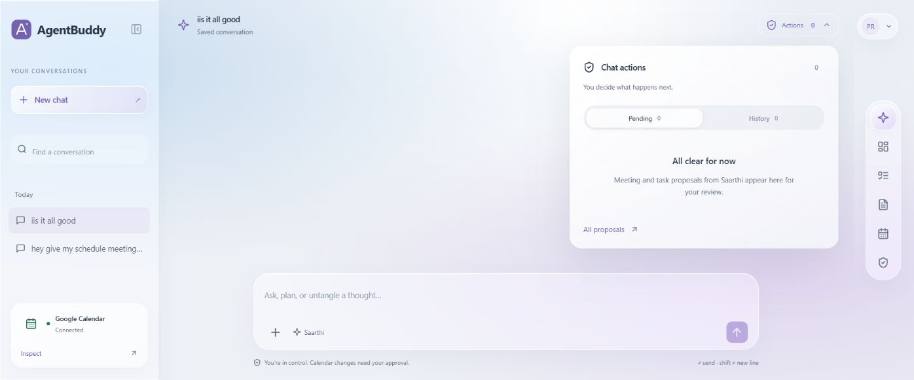
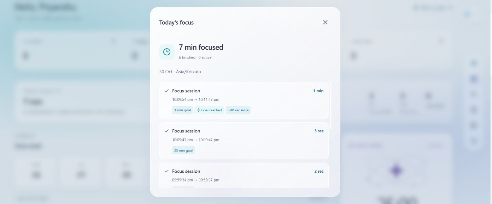
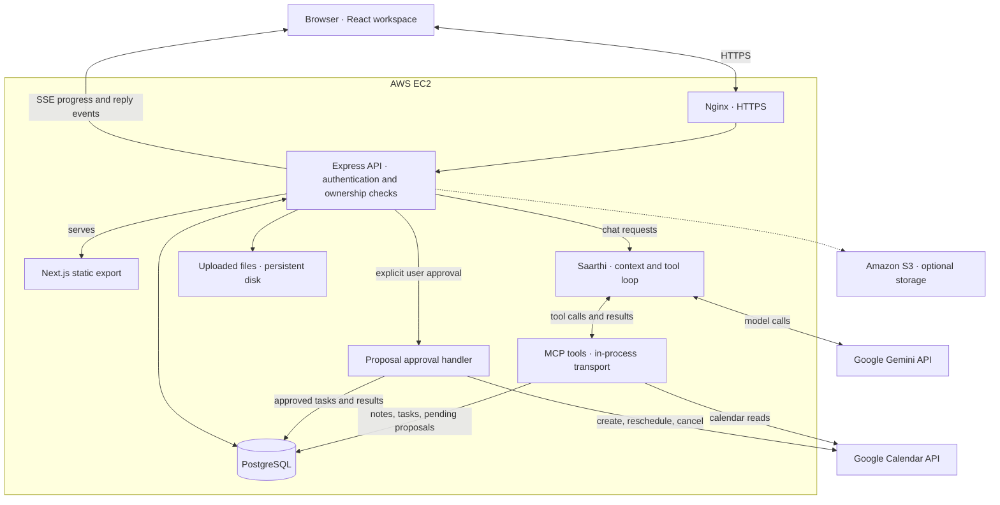

# AgentBuddy

**Your notes, schedule, and next steps in one place.**

AgentBuddy brings chat, Google Calendar, tasks, and focus sessions into a single workspace. Its assistant, **Saarthi**, can look through your saved notes, check your schedule, and suggest actions. You review those actions before anything changes on your calendar.

**[Try the live app → cipherxcel.dev](https://cipherxcel.dev)**

## A look inside

### Saarthi and conversation actions

Chat history stays on the left. Meeting and task proposals sit alongside the conversation, where you can review them before approving.



### Focus history

Start a timed session or work without a countdown. When you finish, you can see the time spent, whether you reached your goal, and any extra time.



*These screenshots were captured during development. The live app includes newer layout refinements.*

## What you can do

- **Ask Saarthi about your work.** Conversations are saved, with summaries of older messages for context. It can browse notes, search their titles and content, and link back to the documents it used.
- **Plan your calendar.** Connect Google Calendar, check availability, and request a meeting, reschedule, or cancellation. Saarthi creates a proposal first; approved meetings can include Google Meet links.
- **Keep notes close to tasks.** Upload PDF, TXT, Markdown, SRT, or VTT files. Add task descriptions and due dates, link supporting notes, and open them from the task's detail view.
- **Track focused work.** Pick a preset or custom duration, or use open focus. Sessions survive navigation, notify you when the goal is reached, and keep recording extra time until you finish.
- **See the day at a glance.** The overview brings together meetings, pending tasks, approvals, and focus activity. Month and week calendar views let you select a day for more detail.
- **Set up your workspace.** Choose your timezone, working hours, meeting length, and theme. White, Dark, Glass, Frost, Bloom, and Sand are available, with mobile navigation and reduced-motion support.

Account settings also include password changes using your current password. Changing it signs out other sessions while keeping your current session active.

## How it works

The app has a Next.js frontend and an Express backend. PostgreSQL stores accounts and workspace data. The backend talks to Gemini and exposes the calendar, notes, and task tools through an in-process MCP connection.



### A request, from chat to calendar

1. You send a message in a saved conversation. The backend checks your session and loads recent messages, an older conversation summary, and your scheduling preferences.
2. Gemini decides which tools it needs. Saarthi runs those tools through MCP with your user ID, so note and task lookups stay within your account.
3. Read requests return information directly. Requests to change meetings or extract tasks create a **pending proposal**.
4. You review and approve the proposal. The backend checks ownership, validates the request, and checks for calendar conflicts before creating or moving an event.
5. The result is saved and returned to the workspace.

MCP runs inside the backend; there is no separate MCP service to deploy. Chat uses server-sent events for tool progress and the final reply.

### Data and account security

- PostgreSQL keeps conversations, summaries, notes, tasks, proposals, focus records, and sessions.
- Document text is extracted for retrieval. Original files use persistent local storage, with S3 available as an option.
- Passwords are hashed with Argon2. Authentication uses short-lived JWT access tokens and rotating refresh tokens.
- Google OAuth tokens are encrypted with AES-256-GCM. API routes and tool calls check ownership before accessing user data.

## Built with

| Part | Stack |
| --- | --- |
| Interface | Next.js, React, TypeScript, CSS, Lucide |
| API | Node.js, Express, TypeScript, Zod |
| Assistant | Gemini API, MCP SDK, server-sent events |
| Database | PostgreSQL |
| Calendar | Google Calendar API and OAuth |
| Hosting | AWS EC2, Nginx, HTTPS, systemd |
| Local / alternative deployment | Docker Compose; Caddy for the container deployment |

## Directory structure

```text
.
├── backend/
│   ├── src/
│   │   ├── index.ts             # Startup and database initialization
│   │   ├── app.ts               # HTTP routes and SSE chat endpoint
│   │   ├── auth.ts              # Login, refresh, logout, password changes
│   │   ├── security.ts          # JWT validation and token encryption
│   │   ├── agent.ts             # Gemini conversation and tool loop
│   │   ├── tools.ts             # MCP tools and proposal execution
│   │   ├── calendar.ts          # Google OAuth and Calendar requests
│   │   ├── notes.ts             # Note browsing and keyword search
│   │   ├── storage.ts           # Uploads, text extraction, file storage
│   │   ├── focus.ts             # Focus-session routes
│   │   ├── db.ts                # Schema, queries, ownership helpers
│   │   └── migrate.ts           # Standalone schema initialization
│   └── .env.example
├── frontend/
│   ├── src/
│   │   ├── app/                 # Main page, layout, icons, and styles
│   │   ├── components/          # Calendar, tasks, focus, profile, proposals
│   │   └── lib/                 # API client, workspace state, date helpers
│   └── public/                  # App images and static assets
├── assets/screenshots/          # Images used in this README
├── scripts/
│   ├── dev-local.mjs            # Starts the frontend and backend together
│   └── stage-frontend.mjs       # Stages the exported frontend
├── .env.example
├── docker-compose.yml
├── Dockerfile
├── Caddyfile
└── package.json                 # Workspace commands
```

## Run it locally

You will need **Node.js 24**, npm, and Docker Compose. Assistant replies need a Gemini API key; the Calendar connection needs Google OAuth credentials.

```sh
git clone https://github.com/CipherXcel/AI-Meeting-Intelligence-Productivity-Assistant.git
cd AI-Meeting-Intelligence-Productivity-Assistant
npm ci
```

Copy `.env.example` to `.env` and `backend/.env`. In PowerShell:

```powershell
Copy-Item .env.example .env
Copy-Item .env.example backend/.env
```

Fill in your database password, secrets, and provider credentials before starting.

<details>
<summary>Environment variables</summary>

| Variable | Value / purpose |
| --- | --- |
| `POSTGRES_PASSWORD` | Password for the Compose database |
| `DATABASE_URL` | PostgreSQL connection string; local Compose exposes port `5443` |
| `JWT_SECRET` | Random secret, at least 32 characters |
| `TOKEN_ENCRYPTION_KEY` | Separate random key: 32 bytes encoded as 64 hex characters |
| `GEMINI_API_KEY` | Gemini API key |
| `GEMINI_MODEL` | Model ID; the example uses `gemini-3.1-flash-lite` |
| `GOOGLE_CLIENT_ID`, `GOOGLE_CLIENT_SECRET` | Google OAuth web-client credentials |
| `APP_URL` | `http://localhost:3100` locally |
| `PUBLIC_URL` | `http://localhost:4000` locally |
| `UPLOAD_DIR` | Persistent upload directory when S3 is not configured |

Run this once for each secret, using a different result for each:

```sh
node -e "console.log(require('node:crypto').randomBytes(32).toString('hex'))"
```

Use the same database password in the root Compose environment and backend connection string. Keep environment files and keys out of Git.

</details>

```sh
docker compose up -d db
npm run dev
```

Open **[localhost:3100](http://localhost:3100)**. The API runs on port **4000** and initializes its schema on startup. The combined dev command sets the local origins automatically.

If you run the services separately, set the origins listed above and add `NEXT_PUBLIC_API_URL=http://localhost:4000` to `frontend/.env.local`.

## Connect Google Calendar

In your Google Cloud project, enable the Calendar API, configure the consent screen, and create an OAuth client with the **Web application** type.

Add these **Authorized redirect URIs** for local development and the live app:

```text
http://localhost:4000/api/calendar/callback
https://cipherxcel.dev/api/calendar/callback
```

For your own deployment, replace `cipherxcel.dev` with your domain. The URI must match `${PUBLIC_URL}/api/calendar/callback` exactly.

Set the client ID and secret in the backend environment, restart the backend, then connect from Profile or the Saarthi sidebar. If your OAuth app is in testing, add your Google account as a test user.

## Deployment

The live app runs on **AWS EC2**, behind **Nginx with HTTPS**. A systemd service keeps the Node.js process running.

```sh
npm run build
npm start
```

The Express server serves both the exported frontend and the API. Its default port is `4000`; change it with `PORT`. Leave `NEXT_PUBLIC_API_URL` unset or empty when building for same-origin production use.

Set `NODE_ENV=production`, and set `APP_URL` and `PUBLIC_URL` to your HTTPS origin. Keep PostgreSQL data and uploaded files on persistent storage. Preserve `TOKEN_ENCRYPTION_KEY` across releases so saved Google connections remain readable.

The repository also includes a Docker Compose deployment with Caddy:

```sh
docker compose --profile production up -d --build
```

For that option, configure the root `.env`, including `DOMAIN`, HTTPS origins, database credentials, and secrets. Compose uses named volumes for PostgreSQL, uploads, and Caddy data.

To use S3 instead of local file storage, set `AWS_S3_BUCKET` and `AWS_REGION`, and give the runtime the required AWS permissions.

## A few things to know

- Availability checks cover your connected primary calendar, not other attendees' calendars.
- Focus sessions appear in AgentBuddy's calendar history; starting focus does not create a Google Calendar event.
- Notes search works on titles and extracted text. Scanned PDFs need OCR before upload.
- Uploads are limited to 10 MB per file and 500 MB per account.
